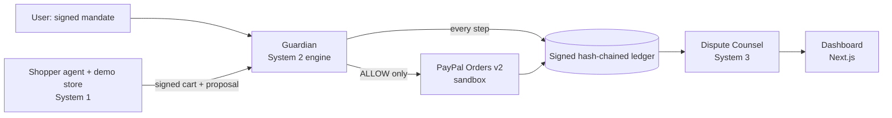

# Gawah

Gawah (Urdu/Hindi for "witness") is an authorization and dispute layer for AI agents that spend money through PayPal. An agent that shops for you needs a spending limit that does not depend on the agent's own words, and a tamper-evident record to review when a charge is disputed. Gawah aims at both: the user signs a **mandate** (what may be bought, from whom, up to how much), the agent can only *propose* a purchase, a **Guardian** decides without reading anything the agent wrote, PayPal pays, every step lands in a signed, hash-chained **ledger**, and **Dispute Counsel** turns that ledger into evidence and a recommendation. Built for the PayPal AI Hackathon. The mandates are **AP2-inspired ES256 signed JSON mandates**, not an AP2 implementation.



## Live demo

- Dashboard (read-only, no login): https://gawah-web.onrender.com
- Engine health: https://gawah-engine.onrender.com/health
- Counsel health: https://gawah-counsel.onrender.com/api/health
- Source: https://github.com/ParrvLuthra22/Gawah
- Video: **VIDEO LINK TO BE ADDED**

The hosted services run on a free tier: the **first load can take up to a minute** while they wake up, and all hosted data
resets on restart. All money is **PayPal sandbox** money. The hosted dashboard is read-only and needs no login (anyone with
the URL can open it). The shopping agent page (`/shop`) is **not hosted**: it can start a sandbox payment, so it runs only on
a local development server.

## How it works

- **Mandate**: user, category, item description, merchant allow-list, integer-cent budget (`8000` = $80.00), expiry; signed ES256. The shopper can read mandates and submit proposals. It has no payment or refund route (`SCOPES` in `engine/gawah_engine/auth.py`).
- **Guardian**: checks the mandate signature, expiry and revocation, the merchant's signed cart (ES256, registered key), price, merchant, currency, remaining budget and duplicates. It never reads the agent's rationale. A constrained category check (sku/title/variant only, wrapped as untrusted) can only add a BLOCK. A wrong size or colour does not block: it is stored as an advisory.
- **Ledger**: write first, pay second. `PAYMENT_STARTED` is committed before any PayPal call; entries are hashed, chained and signed (ES256), the database refuses UPDATE and DELETE, and `/v1/ledger/verify` recomputes everything.
- **Counsel**: assembles an evidence bundle per payment (mandate, signed cart, decision, ledger, PayPal ids), checks it against the engine, and recommends DEFEND, CONCEDE_REMEDY or REQUEST_MORE_EVIDENCE with a Groq model constrained to verified findings.

## How PayPal is used (sandbox only)

Orders v2 (`/v2/checkout/orders`) with the buyer's sandbox card in `payment_source.card`, `PayPal-Request-Id` idempotency keys and `custom_id` pointing back at the ledger entry; capture refunds via `/v2/payments/captures/{id}/refund` (an operator action through the engine, `scripts/refund_demo.py`); and the Disputes API (`/v1/customer/disputes`) read by Counsel. No live PayPal.

## Run it

Needs Python 3.11+, [uv](https://docs.astral.sh/uv/), Node 20+, make. Commands are from the `Makefile`.

```sh
make install                       # uv sync, Counsel's dependencies, npm ci
cp .env.example .env && cp system3/.env.example system3/.env && cp web/.env.example web/.env.local
make dev-all                       # engine 8000, Counsel 8002, web 3000; Ctrl-C stops all (shopper is 8001, not started here)
make e2e                           # shopper -> Guardian -> payment -> ledger, SIMULATED PayPal and models, no network
make rehearse                      # the whole demo in video order; REAL PayPal sandbox payments, needs .env and network
make test                          # engine + contract, Counsel and web tests;  make lint  runs ruff
```

Set the same random `SYSTEM1_KEY` / `SYSTEM3_KEY` values in the env files (`python -c "import secrets; print(secrets.token_urlsafe(32))"`); details in `docs/CONTRACT.md`. `make e2e E2E_MODE=real` runs one real sandbox purchase; `make dev-engine`, `make dev-counsel` and `make dev-web` start one service each. `make e2e` and `make rehearse` details: `integration/README.md`. Hosted demo (Render) and seeding it from a laptop: `docs/DEPLOY.md`.

## What is simulated

- **PayPal money** is sandbox money. `make e2e` and the tests use the engine's fake PayPal (`GAWAH_ENV=test`); `make rehearse` uses the real sandbox.
- **Attacker proposals** in the e2e and rehearsal are built by the harness from System 1's attack fixtures and signed with the demo merchant key. The e2e's language models (the shopper's and the Guardian's category check) are stubs.
- **The wrong-size cart** (size 11 against a size-12 mandate) is crafted the same way: the shopper's catalog has no stock for it.
- **The demo disputes** are `SIMULATED_FIXTURE` records created by Counsel's demo scenarios; outputs say "SIMULATED CASE". Counsel cannot refund them itself; the refund step is an operator refund through the engine.

## Known limits

- The hosted dashboard has **no user login**; anyone with the URL can use it. Only sandbox data.
- Free-tier hosting is **ephemeral**: instances sleep and all hosted data (mandates, ledger, keys, Counsel's database) resets on restart.
- Deleting the **tail** of the ledger leaves a valid shorter chain. Detecting it needs the signed head (`/v1/ledger/head`) anchored somewhere outside the database. Not done. (Reasoned from the design, not tested.)
- The **shopper is not hosted**: its routes have no authentication, so it runs on your machine.
- Counsel reports order, fulfilment and delivery records as unavailable: the contract has none.
- The model step in Counsel is nondeterministic and rate-limited; `make rehearse` retries it once.

## License and team

MIT (`LICENSE`). System 1 (shopper agent, demo store, attack simulation): Suvir, `system1/`. System 2 (authorization, Guardian, payments, ledger, orchestration): Parrv, `engine/`. System 3 (Dispute Counsel, dashboard): Navya, `system3/` and `web/`. Shared contract: `contract/`, `docs/CONTRACT.md`; rules in `OWNERS.md`. Why AP2 is not used directly: `spikes/spikes.md` (C1).
